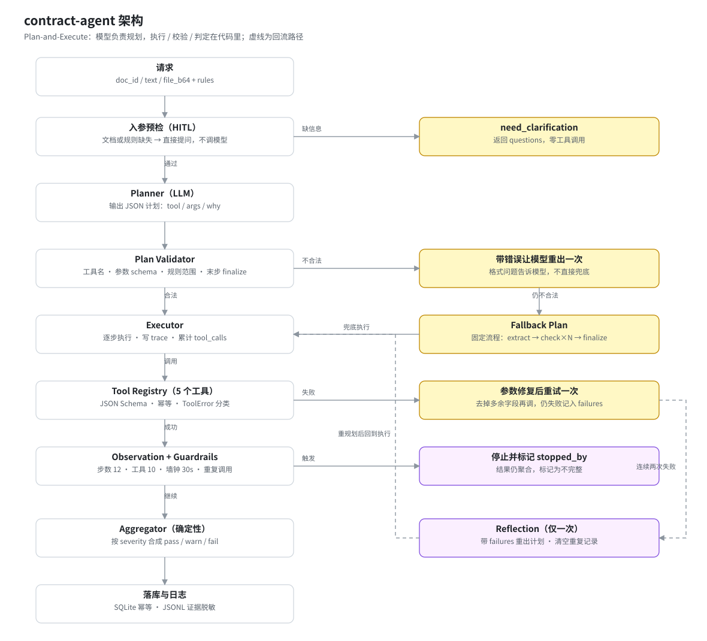

# 合同核查 Agent

给一份合同和一组规则，把它逐条查一遍：哪条规则没过、在第几条、原文是哪句、建议怎么改。最后给一个总判定。

4 份合同和 20 条任务都是造的，规则 R1–R6 也是我自己定的，数字只对这 4 份有效。六条规则是从合同纠纷里最常见的几类反推的，不是从法规条文里逐条抄来的。

## 架构

一次任务从「要不要先问清楚」开始，到「结论落库」结束。中间是一条 Plan-and-Execute 链路：模型只负责规划，执行、校验、判定都在代码里。



_图：请求 → 预检 → 规划 → 校验 → 执行 → 反思 → 合成 → 落库；虚线是回流路径。_

| 层 | 模块 | 职责 |
|---|---|---|
| 接入层 | `agent/api.py` | FastAPI 路由、鉴权、入参校验、超时、幂等查询 |
| 预检（HITL） | `agent/loop.py::_precheck` | 信息不足时返回问题而不是猜 |
| 规划器 Planner | `agent/planner.py` | 把任务转成 `[{tool, args}]` 的计划，注入租户记忆 |
| 计划校验 | `planner.validate_plan` | 静态检查：工具存在、参数 schema、规则范围、末步 finalize |
| 执行器 Executor | `agent/loop.py` | 逐步执行、观察、护栏、重复调用检测 |
| 反思 Reflection | `planner.reflect_plan` | 连续失败后带错误重规划，最多一次 |
| 工具层 Tool Use | `agent/tools.py` | 5 个工具 + JSON Schema + 幂等 + `ToolError` 分类 |
| 判定层 | `agent/policy.py` | 六条规则、证据回查、verdict 聚合（纯函数） |
| 记忆 Memory | `agent/memory.py`、`agent/store.py` | 短期：trace / findings；长期：租户改判与偏好 |
| 观测 | 全链路 | `request_id` 贯穿，日志落盘前脱敏 |

**生命周期**

1. 预检：文档和规则缺一个就先问，不浪费一次模型调用。
2. 规划：LLM 输出计划，格式是受约束的 JSON。
3. 校验：不合法先让模型改一次，再不行走兜底计划（固定流程）。
4. 执行：按计划调工具，每个结果转成 `Finding` 写进 trace。
5. 反思：连续两次工具失败时，把错误喂回模型重出计划；只允许一次，避免来回打转。
6. 合成：`aggregate` 按 severity 得出 pass / warn / fail。
7. 落库：结果进 SQLite，同一租户同参数再次请求直接复用。

**术语对照**

| 通用术语 | 这里的落法 |
|---|---|
| Plan-and-Execute | 计划一次成型，执行逐步推进，不做自由 ReAct |
| Tool Use | 5 个工具，带 JSON Schema 与幂等约束 |
| Reflection | 失败触发的重规划，上限 1 次 |
| Guardrails | 步数 12 / 工具 10 / 墙钟 30s / 重复调用检测 |
| Human-in-the-loop | 信息不足时 `need_clarification` |
| Memory | 租户级改判与规则偏好，规划时注入提示 |
| Idempotency | `(tenant, fingerprint)` 唯一索引，重复提交返回原结果 |
| Observability | `request_id` + 结构化日志 + 证据指纹脱敏 |

**这个架构不做什么**

- 不是自由 ReAct：没有「每步先想一遍再决定」的推理循环，计划一次给全，中途只允许一次重规划。
- 反思不看结论对错：只处理工具执行失败，不评价 verdict 是否合理。
- 记忆不学习规则：只记人工改判和偏好，规则本身仍然写死在 `policy.py`。

## 结构

一次任务从计划开始。模型先出一份 JSON 计划，说要调哪几个工具、按什么顺序；计划和参数先过一遍校验，工具名、参数、规则范围、最后一步是不是 finalize 都要查。

校验过了才进执行循环。循环里只有四个真工具：切条款、查规则、检索、给建议，另外有个 finalize 负责收口。每步都记日志，出问题能定位到是模型给错了参数、工具内部炸了，还是循环本身绕圈。

判断不在模型里。规则命中、取证、结论合成全是普通代码，模型只管「先调哪个工具」。这样同一份合同跑十次结果一样，也能写单测。

不太想让模型直接回答「这条过没过」。它能说得很像，但说不清依据在原文哪一句，出了问题也没法回查。

## 工具

`extract_clauses` 按「第X条」切，没有编号就按段落切。

`check_rule` 是核心，六条规则的判定都在这。比如预付款比例那条：先找含「预付/首款/定金」的条款，把百分比抠出来，超过 30 就算不过。取证之后还要回查一遍原文，片段不在原文里就直接报工具失败——宁可这条查不了，也不能给一段编出来的证据。

`search_clauses` 是关键词检索，用得不多，主要给模型在定位不确定时用。

`draft_fix` 返回模板化的修改建议，按规则给。

## 护栏

四个上限，任一触发就退出并标记原因：步数 12、工具调用 10 次、执行阶段墙钟 30 秒、同工具同参数重复调用。

墙钟这一条踩过坑。一开始把模型规划的时间也算进去，本地 7B 冷启动要 40 秒，第一条任务直接被判超时。后来改成只约束执行阶段——模型多慢是模型的事，不该算任务失败。

## 跑一下

```bash
python -m agent.cli --doc doc_a          # 出结果，证据定位到具体条款
python -m agent.cli --doc doc_zzz        # 找不到文档时直接提问，不硬猜
python eval/run_eval.py                  # 20 条任务评测
python eval/gate.py                      # 门禁，不达标退出非零
python -m unittest discover -s tests     # 37 个测试
```

接真模型时设 `LLM_BASE_URL` 和 `LLM_MODEL`，然后加 `--llm openai`。任何 OpenAI 兼容端点都行，Ollama 的 `/v1` 也可以。

## 评测

Mock 模型下 20 条任务全过，关键词基线 35%。基线低是因为它只看词在不在：预付 50% 有「预付」，它就判通过；争议写「另行协商」，它也判通过。

接本地 qwen2.5:7b 之后成功率还是 100%，但计划兜底率到了 25%——五次里有一次模型给的计划不合法，要么少了 finalize，要么漏了 extract_clauses。这些任务能过，靠的是校验之后走兜底计划，不是模型本身稳。

接真模型之后我最关心的其实是这个数，不是成功率。成功率好看不代表模型稳，兜底率才说明它哪里不行、兜底到底值不值。

## 踩坑

重规划的测试一开始怎么写都不过，`replans` 一直是 0。查下来是校验层太严：我在计划里塞了一个不存在的 doc_id，校验直接判非法，压根没进执行，自然不会失败，也不会触发重规划。

后来改成让工具在运行期抛错（合法参数、内部失败），才真的测到重规划。顺带发现第二个问题：重规划之后，同参数的重试会被「重复调用检测」拦掉，得在重规划时清空调用记录。

## 接口

命令行之外起了个 HTTP 服务，FastAPI + uvicorn，带 OpenAPI 文档。

```bash
pip install -r requirements.txt
set AGENT_API_KEYS=k1:tenant-a,k2:tenant-b
python -m agent.api            # 默认 127.0.0.1:8080
```

起来之后 `http://127.0.0.1:8080/docs` 是自动生成的接口文档，可以直接在页面上试。

```bash
curl -X POST http://127.0.0.1:8080/v1/review \
  -H "X-API-Key: k1" -H "Content-Type: application/json" \
  -d '{"doc_id":"doc_a","rules":["R1","R2"]}'
```

能传 `doc_id`（语料里的文档），也能直接传 `text`，或者传 `file_b64` + `filename` 上传。返回里带 `request_id`，隔一会儿可以用 `GET /v1/results/{request_id}` 再取一次。

几个约束：

- 没有 `X-API-Key` 返回 401；结果按 key 对应的租户存，拿别的租户的 `request_id` 去取返回 403。
- 上传只收 `.txt` / `.md`，单文件 5MB、按 1500 字/页估算不超过 200 页；超了分别是 415、413、422，错误体里有 `code` 和中文说明。
- 单请求超过 `AGENT_TIMEOUT`（默认 30 秒）返回 504，不会把连接挂住。
- 上传的正文只在内存里放一下，请求结束就释放，不落盘。

`/healthz` 不需要鉴权，方便探活。

## 局限

- 语料只有 4 份合同，规则是硬编码的六条，没有从法规里抽。
- 只做单轮任务，不能追问澄清到一半再来一轮（会返回待补充信息，但不会自己续跑）。
- Mock 下的 100% 只说明流程正确，不代表模型能力强。
- 真模型下兜底率 25%，说明提示词还有优化空间。我没继续调，先把评测做实。
