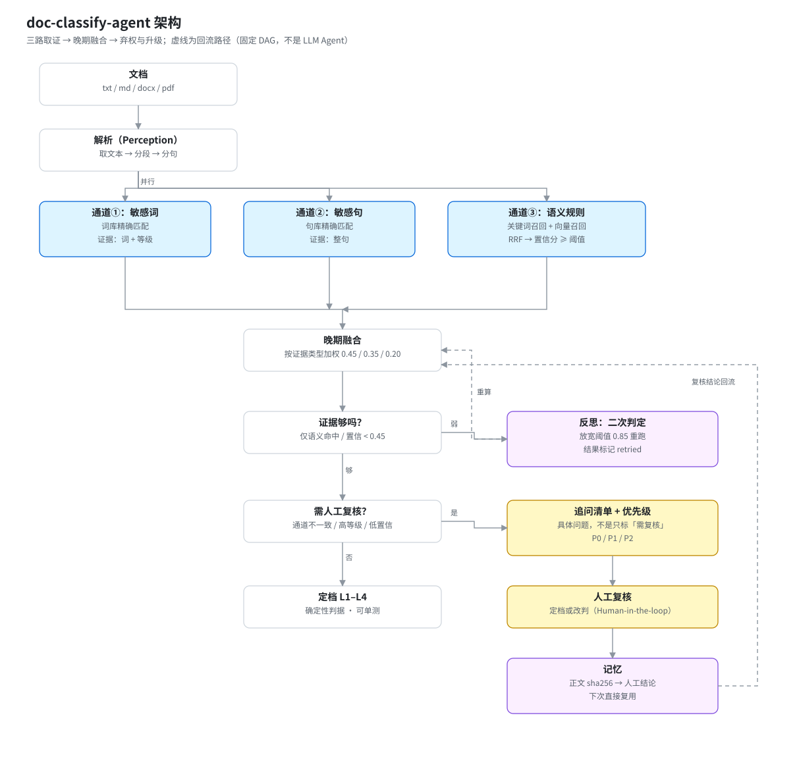

# 文档敏感度分级

给一份文档，判它属于哪一档敏感等级（L1–L4），同时给出判定的原文句子，以及是否需要人工复核。

词库、句库、规则都是我自己造的样例，8 份文档也是造的，跑出来的数字只对这份样例集有效。

## 架构

算是一种决策型 Agent。没有 planner、没有工具调用、没有自主决策，是一条**固定 DAG 的判定流水线**，加上人工审查。



_图：三路取证 → 晚期融合 → 弃权与升级；虚线是回流路径。_

| 层             | 模块                            | 职责                       |
| ------------- | ----------------------------- | ------------------------ |
| 接入层           | `agent/api.py`                | FastAPI 路由、鉴权、入参校验、超时、幂等 |
| 感知 Perception | `agent/parse.py`              | 文本抽取、分段、按配置分句            |
| 检索通道 Channels | `agent/channels.py`           | 三路各自出「等级 + 证据」，互不依赖      |
| 融合 Fusion     | `agent/fusion.py`             | 晚期融合（证据类型加权）、冲突判定、复核原因   |
| 反思 Reflection | `agent/agent.py`              | 证据弱时放宽阈值重跑，标记 `retried`  |
| 弃权与升级         | `fusion` + `agent._questions` | 不确定就不给结论，转人工并生成具体问题      |
| 记忆 Memory     | `agent/memory.py`             | 正文 sha256 为键，记住人工结论      |
| 持久化           | `agent/store.py`              | 结果与幂等指纹落 SQLite          |
| 观测            | 全链路                           | `request_id` 贯穿，证据只留指纹   |

**判定流程**

1. 解析：按扩展名取文本；分句终止符按 `default / legal / report` 配置。
2. 取证：三路并行检索，每路给出自己的等级和证据句。
3. 融合：按证据类型加权（词 0.45、句 0.35、语义 0.20），取加权票最高的一档。
4. 弃权：三路不一致、仅语义命中、L3/L4、加权分低于 0.45，全部转人工。
5. 反思：证据弱时放宽语义阈值重跑一次，多召回的条目照样进复核队列。
6. 定档：通过上述检查才自动出结论。

**术语对照**

| 通用术语              | 这里的落法                        |
| ----------------- | ---------------------------- |
| 多通道集成             | 词库 / 句库 / 语义规则三路，盲区不重叠       |
| 晚期融合（late fusion） | 各自出结论后再加权，不合并中间分数            |
| 弃权（abstention）    | 不确定就不给档，转人工                  |
| 升级（escalation）    | 按 L4/L3 → 低置信 → 其他排 P0/P1/P2 |
| Human-in-the-loop | 复核清单带具体问题，不是只标记「需复核」         |
| 确定性判据             | 同一输入永远同一结论，可单测               |
| 幂等                | 正文 + profile 指纹，重复提交复用结果     |

**两个常被混淆的点**

- **阈值不是权重**：0.45 是「这一路算不算命中」的准入线；0.45 / 0.35 / 0.20 是融合时各路的权重。两者数值碰巧相同，作用完全不同，改一个不影响另一个。
- **反思不是自我批评**：它只放宽召回阈值再算一次，不评估「上一轮判得对不对」。

## 怎么判定

先把文档拆成句子。这一步比看起来重要，因为后面三路都是按句子匹配的；分句的终止符做成了配置，合同类文档只按句号和分号切，避免把引用语切断。

然后三路并行跑：

词库匹配。词库是我手工整理的，每个词带一个等级，命中最高的那个就是这一路的结论。真实场景里这类词一般由专家按分级规则批量生成，量级比这里大得多。

句库匹配。历史句子的整句匹配，比词多带一点语境——同一个词在普通句子里不敏感，在特定表述里敏感。

语义规则。每条规则有自己的关键词和描述，先用关键词和向量各召回一批候选句，再用 RRF 合成一个排序，取最佳句算置信分，过阈值才算命中。RRF 是因为两路分数没法直接比：关键词那边是词频分，向量那边是余弦，量纲不一样，只按排名融合就不用归一化了。

三路各出一个等级，融合层按证据类型加权（词 0.45、句 0.35、语义 0.20），最后定档。

## 人工审查什么时候干预

四类情况会进复核队列：

- 三路结论不一致。这里我选了「不自动降级」：词库说是 L3，句库和语义说 L2，那就按 L2 出结论，但这一单必须人确认，不能系统自己压下去。错杀一份还能改回来，漏放一份就回不来了，所以我宁可多转人工。
- 只有语义命中。这条证据没法回溯到库，只能算推测。
- L3 以上。合规场景不接受自动放行。
- 加权分低于 0.45。

复核队列按 L4/L3 → 低置信 → 其他排 P0、P1、P2。

## 运行

```bash
python -m agent.cli --doc d3                 # 单份文档
python -m agent.cli --doc d3 --only semantic # 只跑语义通道
python -m agent.cli --doc d7 --json          # 结构化输出
python eval/run_eval.py                      # 通道消融
python -m unittest discover -s tests         # 36 个测试
```

只有 txt 不需要额外依赖。docx 和 pdf 要装 pip install -r requirements.txt（python-docx、PyMuPDF）。

## 消融

8 份文档，其中 d7 和 d8 是故意造的：d7 换了说法，词库句库全空，只有语义能抓；d8 的表述在规则之外，只有词库能抓。

| 方案    | 等级准确率 | 严重漏检率 |
| ----- | ----- | ----- |
| 仅敏感词  | 75%   | 12%   |
| 仅敏感句  | 62%   | 38%   |
| 仅语义规则 | 88%   | 12%   |
| 三路融合  | 100%  | 0%    |

准确率不是重点。**严重漏检**才是：把 L4 判成 L1，在分级场景里是要出事的，不是「误差可接受」。

代价是复核率被抬到 75%，因为不一致就转人工。实际部署时一般靠「高等级必复核、低等级抽样」压人工成本，而不是放宽规则。

## 做过的取舍

没上 ES、Milvus、大模型。用了内存倒排、TF-IDF 向量和确定性打分。原因很简单：评测要能离线复现，接了外部服务就没法保证「昨天 88%、今天还是 88%」。代价是语义召回比真 embedding 差一截，接真模型之后阈值要重标——现在的分落在 0.2–0.4，模型置信度一般 0.8–0.95 且不校准，同一个 0.45 的阈值会直接失效。

**索引按 (doc_id, profile) 缓存。** 第一版每次 classify 都重建倒排和向量索引，跑评测时慢得明显，加了缓存快 1.5 倍，文档越大差距越大。

**融合权重是手调的。** 0.45 / 0.35 / 0.2 来自「词和句能回溯到具体词句，语义规则回溯不到」这个判断，没做过权重网格搜索。

## 接口

命令行之外起了个 HTTP 服务，FastAPI + uvicorn，带 OpenAPI 文档。

```bash
pip install -r requirements.txt
set AGENT_API_KEYS=k1:tenant-a,k2:tenant-b
python -m agent.api            # 默认 127.0.0.1:8081
```

`http://127.0.0.1:8081/docs` 可以直接试接口。

```bash
curl -X POST http://127.0.0.1:8081/v1/classify \
  -H "X-API-Key: k1" -H "Content-Type: application/json" \
  -d '{"doc_id":"d3","profile":"default"}'
```

`doc_id`、`text`、`file_b64` 三种入参都行。返回带 `request_id`，可以用 `GET /v1/results/{request_id}` 再取。

约束和合同那个一致：缺 key 401，跨租户取结果 403，只收 `.txt` / `.md`，5MB、200 页上限，超时 504，上传正文不落盘。`profile` 只认 `default` / `legal` / `report`，传错返回 422。

## 已知问题

- 语料只有 8 份，样本太少。d7 和 d8 是我为了让某一路必漏而专门造的，严格说不算独立样本，所以那个 100% 我自己也不敢全信。
- 没有处理跨段落引用，比如「见附件二提到的型号」。
- 语义通道是确定性打分，没接大模型。
- 复核改判还没有回流到评估集，现在只做了记忆复用。

## 关于这个仓库

独立实现，用合成数据，不含真实规则、客户信息或生产配置。所有指标只对上面这 8 份文档有效。
